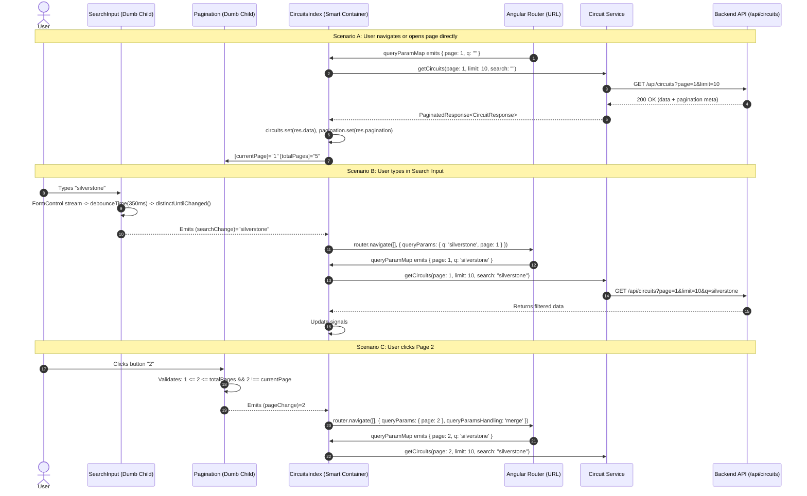

# 🔍 Comprehensive Guide: Reusable Search & Pagination Architecture

A complete, line-by-line developer guide explaining the reactive Search and Pagination components in Angular. This document covers fundamental Angular concepts (Signals, `computed()`, `FormControl`, RxJS pipelines), data contracts, URL synchronization, and the full, annotated source code for all components and templates.

---

## 📑 Table of Contents

1. [Core Angular Concepts Explained (The "Why" & "What")](#1-core-angular-concepts-explained-the-why--what)
   - [What is a Signal (`signal`)?](#what-is-a-signal-signal)
   - [What is a Computed Signal (`computed`)?](#what-is-a-computed-signal-computed)
   - [Why do we use `FormControl` instead of `[(ngModel)]`?](#why-do-we-use-formcontrol-instead-of-ngmodel)
   - [What are `input()` and `output()`?](#what-are-input-and-output)
   - [What is `DestroyRef` and `takeUntilDestroyed`?](#what-is-destroyref-and-takeuntildestroyed)
   - [What is Debouncing (`debounceTime`) and `distinctUntilChanged`?](#what-is-debouncing-debouncetime-and-distinctuntilchanged)
   - [Why is the URL the Single Source of Truth?](#why-is-the-url-the-single-source-of-truth)
2. [High-Level Architecture & Flow](#2-high-level-architecture--flow)
3. [File-by-File Breakdown with Line-by-Line Comments](#3-file-by-file-breakdown-with-line-by-line-comments)
   - [File 1: Data Models (`src/app/models/paginated-response.ts`)](#file-1-data-models-srcappmodelspaginated-responsets)
   - [File 2: Backend Service (`src/app/services/circuit.ts`)](#file-2-backend-service-srcappservicescircuitts)
   - [File 3: Search Component TypeScript (`src/app/components/search-input/search-input.ts`)](#file-3-search-component-typescript-srcappcomponentssearch-inputsearch-inputts)
   - [File 4: Search Component Template (`src/app/components/search-input/search-input.html`)](#file-4-search-component-template-srcappcomponentssearch-inputsearch-inputhtml)
   - [File 5: Pagination Component TypeScript (`src/app/components/pagination/pagination.ts`)](#file-5-pagination-component-typescript-srcappcomponentspaginationpaginationts)
   - [File 6: Pagination Component Template (`src/app/components/pagination/pagination.html`)](#file-6-pagination-component-template-srcappcomponentspaginationpaginationhtml)
   - [File 7: Parent Container TypeScript (`src/app/components/circuits-index/circuits-index.ts`)](#file-7-parent-container-typescript-srcappcomponentscircuits-indexcircuits-indexts)
   - [File 8: Parent Container Template (`src/app/components/circuits-index/circuits-index.html`)](#file-8-parent-container-template-srcappcomponentscircuits-indexcircuits-indexhtml)
4. [Step-by-Step Guide: Adding Search & Pagination to Another Page](#4-step-by-step-guide-adding-search--pagination-to-another-page)
5. [Troubleshooting & Frequently Asked Questions](#5-troubleshooting--frequently-asked-questions)

---

## 1. Core Angular Concepts Explained (The "Why" & "What")

Before looking at the code, let's clarify the key Angular building blocks used throughout this implementation.

---

### What is a Signal (`signal`)?

A **Signal** is Angular's modern reactive primitive for managing state. Think of a Signal as a wrapper around a value that can notify interested consumers (like HTML templates or other calculations) whenever that value changes.

```typescript
// 1. Creating a signal with an initial value:
const count = signal<number>(0);

// 2. Reading the signal's current value (call it like a function):
console.log(count()); // Outputs: 0

// 3. Updating the signal's value:
count.set(5); // Now count() is 5

// 4. Updating based on the previous value:
count.update(current => current + 1); // Now count() is 6
```

#### Why use Signals instead of standard properties (e.g. `circuits: Circuit[] = []`)?
* **Fine-Grained Reactivity**: With regular variables, Angular relies on Zone.js to check the entire component tree whenever an event happens (dirty checking). With Signals, Angular knows **precisely** which DOM element depends on which signal and updates only that specific element.
* **Predictable & Synchronous**: Reading a signal is instant and synchronous, unlike RxJS Observables which require `.subscribe()` or the `async` pipe.
* **Template Syntax**: In the HTML template, you invoke it like a function: `@if (loading())`, `{{ circuit.name }}`, etc. When `loading.set(true)` is called, the template automatically reflects the change without manual trigger.

---

### What is a Computed Signal (`computed`)?

A **Computed Signal** is a read-only signal whose value is derived from other signals.

```typescript
const count = signal(2);
const doubleCount = computed(() => count() * 2);

console.log(doubleCount()); // 4
count.set(5);
console.log(doubleCount()); // 10
```

#### Why do we use `computed` in [`Pagination`](file:///opt/lampp/htdocs/track_your_time/frontend/src/app/components/pagination/pagination.ts#L15)?
In our pagination component, the list of visible page buttons depends on both `currentPage()` and `totalPages()`. Whenever the user changes pages or new data changes `totalPages()`, the `pages` signal recalculates itself automatically:
* **Automatic Dependency Tracking**: Angular tracks any signal read inside the `computed(() => ...)` callback. You don't need to write manual event listeners.
* **Memoization (Caching)**: Angular only recalculates the value if `currentPage` or `totalPages` actually changes. If neither changes, it returns the cached array.

---

### Why do we use `FormControl` instead of `[(ngModel)]`?

You might wonder: *"Why didn't we just use a two-way binding like `<input [(ngModel)]="searchQuery" (input)="onSearch()"/>`?"*

The answer is **Reactive Streams & Control**:
1. **Direct Access to RxJS Streams**: A `FormControl` provides a `.valueChanges` Observable stream. This allows us to apply powerful RxJS operators like `debounceTime()` and `distinctUntilChanged()`.
2. **Without `FormControl`**: If you listen to `(input)` directly, every single keypress sends an event. If the user types "Silverstone" quickly (11 keystrokes), your application would trigger 11 HTTP requests to the backend!
3. **Decoupled State**: With `FormControl`, we can update the input text programmatically (like pre-filling from the URL query params) with `{ emitEvent: false }` so it does not trigger a recursive HTTP request loop.

---

### What are `input()` and `output()`?

Angular 17+ introduced signal-based inputs and cleaner outputs, replacing the legacy `@Input()` and `@Output()` decorators:

| Legacy Decorator | Modern Signal API | Key Advantage |
| :--- | :--- | :--- |
| `@Input() currentPage: number = 1;` | `currentPage = input<number>(1);` | Returns a Signal! You can read `currentPage()` or use it inside `computed()`. |
| `@Input({ required: true }) total!: number;` | `totalPages = input.required<number>();` | Compile-time guarantee that the parent **must** provide this attribute, otherwise Angular throws a build error. |
| `@Output() pageChange = new EventEmitter<number>();` | `pageChange = output<number>();` | Lighter syntax, cleaner internal typing, does not instantiate unnecessary RxJS Subjects. |

---

### What is `DestroyRef` and `takeUntilDestroyed`?

When you subscribe to an RxJS stream (like `this.searchControl.valueChanges.subscribe(...)`), the subscription stays alive in memory even if the user navigates away to another page. This is called a **memory leak**.

In modern Angular:
* `DestroyRef` is an injectable token that represents the lifecycle of the current component instance.
* `takeUntilDestroyed(this.destroyRef)` automatically terminates (unsubscribes) the stream the exact moment the component is removed from the DOM.
* No need to implement `ngOnDestroy()`, create `Subject` cleanup flags, or call `subscription.unsubscribe()`.

---

### What is Debouncing (`debounceTime`) and `distinctUntilChanged`?

In [`SearchInput`](file:///opt/lampp/htdocs/track_your_time/frontend/src/app/components/search-input/search-input.ts#L28-L32):

```typescript
this.searchControl.valueChanges.pipe(
  debounceTime(this.debounceMs()), // e.g. 350ms
  distinctUntilChanged(),
  takeUntilDestroyed(this.destroyRef)
)
```

1. **`debounceTime(350)`**:
   - Imagine the user types: `M` -> 50ms -> `o` -> 50ms -> `n` -> 50ms -> `z` -> 50ms -> `a`.
   - Instead of firing 5 backend API requests, `debounceTime` pauses. It waits until 350 milliseconds have passed *without any new keystrokes*.
   - Only when the user pauses typing does it emit `"Monza"`. This cuts API traffic by up to 90%!
2. **`distinctUntilChanged()`**:
   - If the user types "a", then hits Backspace, then types "a" again within the debounce window, the net value hasn't changed.
   - Or if the user hits the Left Arrow, Right Arrow, Shift, or Alt key, the value is identical.
   - `distinctUntilChanged()` discards emissions that match the previous value.

---

### Why is the URL the Single Source of Truth?

Notice that when the user types in the search bar or clicks page "3", our components **do not** call `this.circuitService.getCircuits()` immediately.
Instead, they do this:

```typescript
this.router.navigate([], {
  relativeTo: this.route,
  queryParams: { page: 3 },
  queryParamsHandling: 'merge',
});
```

And in `ngOnInit`, we listen to the URL parameters:

```typescript
this.route.queryParamMap.subscribe(params => {
  const page = Number(params.get('page')) || 1;
  const q = params.get('q') || '';
  this.loadCircuits(page, q);
});
```

#### Why is this pattern essential?
1. **Browser Back & Forward Buttons Work**: If the user is on page 3 and clicks the browser's "Back" button, the URL changes to page 2, `queryParamMap` emits, and the page updates to page 2 seamlessly.
2. **Bookmarking & Sharing**: A user can bookmark `http://localhost:4200/circuits?page=2&q=spa` or share it on Discord. When their friend opens the link, the exact same search and page are rendered!
3. **Hard Page Refresh**: If the user presses F5 / Ctrl+R, they do not lose their active search query or page position.
4. **`q: query || null` Trick**: When a query string is empty (`""`), setting it to `null` tells the Angular Router to completely delete `?q=` from the address bar, keeping URLs clean and tidy.
5. **Resetting `page: 1` on Search**: If you are on page 8 of a list and type "Monza", there might only be 1 page of results. If you stayed on page 8, you would see "No circuits found." Resetting to `page: 1` ensures you always see results from the beginning.

---

## 2. High-Level Architecture & Flow



---

## 3. File-by-File Breakdown with Line-by-Line Comments

Here is every file involved in this system. Each file is presented with full code and detailed comments on each line.

---

### File 1: Data Models (`src/app/models/paginated-response.ts`)

* **File Location**: [`src/app/models/paginated-response.ts`](file:///opt/lampp/htdocs/track_your_time/frontend/src/app/models/paginated-response.ts)
* **Purpose**: Defines TypeScript interfaces representing the shape of paginated JSON payloads returned by backend endpoints.

```typescript
// ==========================================
// File: src/app/models/paginated-response.ts
// ==========================================

// Defines the pagination metadata object returned by Symfony / backend API
export interface PaginationMeta {
    // Current active page index (1-based, e.g., 1, 2, 3...)
    page: number;

    // Maximum number of items requested per page (e.g., 10)
    limit: number;

    // Total count of matching items in the entire database (e.g., 42)
    total: number;

    // Total calculated number of pages: Math.ceil(total / limit)
    totalPages: number;
}

// Generic wrapper interface for any entity (Circuits, Cars, Users, etc.)
// The generic parameter <T> allows this interface to be reused across all entities
export interface PaginatedResponse<T> {
    // Array of entities of type T for the current page
    data: T[];

    // Metadata describing the pagination status
    pagination: PaginationMeta;
}
```

#### Line-by-Line Highlights:
* **Line 4 (`PaginationMeta`)**: Guarantees consistent property naming (`page`, `limit`, `total`, `totalPages`) across all frontend components.
* **Line 11 (`PaginatedResponse<T>`)**: Uses TypeScript generics `<T>`. When fetching circuits, `T` is [`CircuitResponse`](file:///opt/lampp/htdocs/track_your_time/frontend/src/app/models/circuit-response.ts). When fetching cars, `T` is `CarResponse`. The pagination metadata structure remains 100% identical.

---

### File 2: Backend Service (`src/app/services/circuit.ts`)

* **File Location**: [`src/app/services/circuit.ts`](file:///opt/lampp/htdocs/track_your_time/frontend/src/app/services/circuit.ts)
* **Purpose**: Encapsulates HTTP communication with the Symfony backend `/api/circuits` endpoint using Angular's `HttpClient`.

```typescript
// ==========================================
// File: src/app/services/circuit.ts
// ==========================================

// Import Angular HTTP client tools for sending REST API requests and configuring URL parameters
import { HttpClient, HttpParams } from '@angular/common/http';

// Import dependency injection decorators and utilities
import { inject, Injectable } from '@angular/core';

// Import RxJS Observable types and operators for handling asynchronous responses
import { catchError, map, Observable, throwError } from 'rxjs';

// Import the specific entity model interface for circuits
import { CircuitResponse } from '../models/circuit-response';

// Import the generic paginated response structure defined in File 1
import { PaginatedResponse } from '../models/paginated-response';

// Declare this service as a singleton available throughout the entire application root injector
@Injectable({
  providedIn: 'root',
})
export class Circuit {
  // Inject Angular's HttpClient instance using modern inject() function (instead of constructor injection)
  private http = inject(HttpClient);

  // Method to fetch a paginated, searchable list of circuits from the backend
  // Parameters have default values: page 1, 10 items per page, empty search query
  getCircuits(page: number = 1, limit: number = 10, search: string = ""): Observable<PaginatedResponse<CircuitResponse>> {
    
    // Construct query parameters: ?page=...&limit=...
    // Note: HttpParams in Angular is immutable. Each .set() returns a new HttpParams object!
    let params = new HttpParams()
                      .set("page", page.toString()) // Convert number to string for HTTP query param
                      .set("limit", limit.toString()); // Convert limit to string
    
    // Check if a search term was provided (ignoring surrounding whitespace)
    if(search.trim()) {
      // Append &q=search_term to the query parameters
      params = params.set("q", search.trim());
    }

    // Execute the HTTP GET request to /api/circuits
    // Pass the constructed params and withCredentials: true so session cookies/JWT are sent along
    return this.http.get<PaginatedResponse<CircuitResponse>>("/api/circuits", { params, withCredentials: true });
  }
}
```

#### Line-by-Line Highlights:
* **Line 11 (`inject(HttpClient)`)**: Uses Angular's modern `inject()` syntax instead of `constructor(private http: HttpClient)`.
* **Lines 14-16 (`HttpParams`)**: Angular's `HttpParams` is immutable. Calling `.set(...)` returns a new instance, so assigning it to `let params` is mandatory.
* **Line 18 (`if(search.trim())`)**: Only adds `q` parameter if there is meaningful text, avoiding `?q=` in the backend query.
* **Line 22 (`withCredentials: true`)**: Essential for cookie-based authentication / CORS sessions between frontend (port 4200) and backend (port 8000).

---

### File 3: Search Component TypeScript (`src/app/components/search-input/search-input.ts`)

* **File Location**: [`src/app/components/search-input/search-input.ts`](file:///opt/lampp/htdocs/track_your_time/frontend/src/app/components/search-input/search-input.ts)
* **Purpose**: A self-contained, reusable search bar component with built-in debouncing, clear button support, and lifecycle memory leak protection.

```typescript
// ==============================================================
// File: src/app/components/search-input/search-input.ts
// ==============================================================

// Angular core decorators, lifecycle hooks, and signal-based input/output functions
import { Component, DestroyRef, inject, input, OnInit, output } from '@angular/core';

// Angular Reactive Forms classes: FormControl manages an individual input value and its events
import { FormControl, ReactiveFormsModule } from '@angular/forms';

// RxJS operators to control emission timing and avoid duplicate queries
import { debounceTime, distinctUntilChanged } from 'rxjs';

// RxJS Interop tool to automatically unsubscribe when the component is destroyed
import { takeUntilDestroyed } from '@angular/core/rxjs-interop';      

@Component({
  // The custom HTML tag name used to render this component: <app-search-input></app-search-input>
  selector: 'app-search-input',

  // Must import ReactiveFormsModule to use [formControl] in the template
  imports: [ReactiveFormsModule],

  // Link to external HTML template
  templateUrl: './search-input.html',

  // Link to external CSS stylesheet
  styleUrl: './search-input.css',
})
export class SearchInput implements OnInit {
  // Inject component lifecycle destruction hook to manage RxJS stream cancellation
  private destroyRef = inject(DestroyRef);

  // --- COMPONENT INPUTS (Customizable by parent) ---
  // Input signal for placeholder text; defaults to "Search..." if not specified by parent
  placeholder = input<string>("Search...");

  // Input signal for debounce delay in milliseconds; defaults to 350ms
  debounceMs = input<number>(350);

  // Input signal to pre-fill the search box (e.g., when the URL already has ?q=something)
  initialValue = input<string>("");

  // --- COMPONENT OUTPUTS (Events emitted to parent) ---
  // Emits the debounced search text string to the parent component
  searchChange = output<string>();

  // --- INTERNAL FORM CONTROL ---
  // Reactive form control tracking the live text inside the <input> element
  searchControl = new FormControl("");

  // Component initialization lifecycle hook
  ngOnInit(): void {
    // Step 1: If an initial value was passed (e.g. from URL query param ?q=monza)
    if(this.initialValue()) {
      // Set the input field's text without firing the valueChanges observable!
      // emitEvent: false prevents an accidental search emission on page load
      this.searchControl.setValue(this.initialValue(), {emitEvent: false});
    }

    // Step 2: Establish the reactive pipeline on user typing
    this.searchControl.valueChanges
      .pipe(
        // Wait for user to stop typing for debounceMs (default 350ms)
        debounceTime(this.debounceMs()),

        // Discard emissions if the text is identical to the previous emission
        distinctUntilChanged(),

        // Automatically unsubscribe when this component instance is destroyed
        takeUntilDestroyed(this.destroyRef)
      )
      .subscribe(value => {
        // Emit the sanitized value to parent (convert null/undefined to empty string)
        this.searchChange.emit(value ?? "");
      });
  }

  // Helper method called when user clicks the "✕" clear button
  clear(): void {
    // Setting value to "" triggers valueChanges, which will emit "" to parent after debounce
    this.searchControl.setValue("");
  }
}
```

#### Line-by-Line Highlights:
* **Line 13 (`destroyRef = inject(DestroyRef)`)**: Grab a reference to when this component gets destroyed.
* **Lines 15-17 (`input<string>()`)**: Signal-based inputs. If the parent updates `[initialValue]="searchQuery()"`, this component reads the signal via `this.initialValue()`.
* **Line 19 (`output<string>()`)**: Modern Angular output. Replaces `@Output() searchChange = new EventEmitter<string>()`.
* **Line 21 (`searchControl = new FormControl("")`)**: The bridge between the raw DOM `<input>` and RxJS. It captures every keystroke as a stream.
* **Line 25 (`{ emitEvent: false }`)**: **Crucial!** If we didn't specify `{ emitEvent: false }`, pre-filling the search box from `?q=silverstone` would emit a change event, causing a redundant search and triggering an extra HTTP request!
* **Lines 28-35 (The RxJS Pipe)**:
  - `debounceTime(this.debounceMs())`: Wait 350ms after user pauses typing.
  - `distinctUntilChanged()`: Do not emit if the text hasn't changed.
  - `takeUntilDestroyed(this.destroyRef)`: Prevent memory leaks.
  - `.subscribe(...)`: Emit the final string to parent via `this.searchChange.emit(...)`.
* **Lines 38-40 (`clear()`)**: Clears the input, which flows through the pipe and emits `""` to the parent to reset search filters.

---

### File 4: Search Component Template (`src/app/components/search-input/search-input.html`)

* **File Location**: [`src/app/components/search-input/search-input.html`](file:///opt/lampp/htdocs/track_your_time/frontend/src/app/components/search-input/search-input.html)
* **Purpose**: HTML template displaying the input field and conditional clear button.

```html
<!-- ============================================================== -->
<!-- File: src/app/components/search-input/search-input.html       -->
<!-- ============================================================== -->

<!-- Outer wrapper with relative positioning so the clear button can be absolutely positioned inside it -->
<div class="relative w-full max-w-md">                                                                                                                                                                                                                       
  <!-- The text input element -->
  <input                                                                                                                                                                                                                                                     
    type="text"                                                                                                                                                                                                                                              
    <!-- Bind the FormControl instance from our TypeScript class to this DOM element -->
    [formControl]="searchControl"                                                                                                                                                                                                                            
    <!-- Call the placeholder() signal to retrieve its current string value -->
    [placeholder]="placeholder()"                                                                                                                                                                                                                            
    <!-- Tailwind styling for dark theme, focus states, and rounded border -->
    class="w-full px-4 py-2 border border-gray-700 bg-neutral-900 text-white rounded-lg focus:outline-none focus:border-red-500 transition-colors"                                                                                                           
  />                                                                                                                                                                                                                                                         

  <!-- Angular modern Control Flow: Only render the clear button if searchControl has text -->
  @if (searchControl.value) {                                                                                                                                                                                                                                
    <!-- Clear button positioned on the right side inside the input box -->
    <button                                                                                                                                                                                                                                                  
      type="button"                                                                                                                                                                                                                                          
      <!-- On click, call the clear() method in our TypeScript class -->
      (click)="clear()"                                                                                                                                                                                                                                      
      class="absolute right-3 top-1/2 -translate-y-1/2 text-gray-400 hover:text-white"                                                                                                                                                                       
    >                                                                                                                                                                                                                                                        
      ✕                                                                                                                                                                                                                                                      
    </button>                                                                                                                                                                                                                                                
  }                                                                                                                                                                                                                                                          
</div> 
```

#### Line-by-Line Highlights:
* **Line 4 (`[formControl]="searchControl"`)**: Binds this `<input>` directly to our reactive `searchControl`. Angular automatically syncs whatever the user types into the control's value.
* **Line 5 (`[placeholder]="placeholder()"`)**: Notice the parentheses `()`! Because `placeholder` is an `input()` signal, we evaluate it as a getter function.
* **Line 8 (`@if (searchControl.value)`)**: Uses Angular 17+ control flow syntax (`@if` instead of `*ngIf`). If the user hasn't typed anything, the `✕` button does not exist in the DOM. As soon as a letter is typed, it pops into view.
* **Line 11 (`(click)="clear()"`)**: When clicked, calls `clear()`, emptying the input and firing an emit.

---

### File 5: Pagination Component TypeScript (`src/app/components/pagination/pagination.ts`)

* **File Location**: [`src/app/components/pagination/pagination.ts`](file:///opt/lampp/htdocs/track_your_time/frontend/src/app/components/pagination/pagination.ts)
* **Purpose**: A presentational pagination component featuring an intelligent sliding-window algorithm that generates visible page buttons without overwhelming the screen.

```typescript
// ==============================================================
// File: src/app/components/pagination/pagination.ts
// ==============================================================

// Import core Angular primitives: Component, computed signal, input signal, and output event emitter
import { Component, computed, input, output } from '@angular/core';

@Component({
  // The custom HTML tag name used to render this component: <app-pagination></app-pagination>
  selector: 'app-pagination',

  // No special modules needed (we use built-in control flow @if, @for)
  imports: [],

  // External HTML template
  templateUrl: './pagination.html',

  // External CSS styles
  styleUrl: './pagination.css',
})
export class Pagination {
  // --- REQUIRED INPUTS ---
  // The current active page number (1-based index).
  // input.required ensures parent MUST provide [currentPage]="...", or Angular fails at compile time!
  currentPage = input.required<number>();

  // The total number of pages calculated by backend (totalPages = Math.ceil(total / limit))
  totalPages = input.required<number>();

  // --- OUTPUT EVENT ---
  // Emits the target page number to parent when user clicks "Previous", "Next", or a page number
  pageChange = output<number>();

  // --- COMPUTED SIGNAL: SLIDING WINDOW ALGORITHM ---
  // Computes a 5-page window centered around the current page (e.g., [3, 4, 5, 6, 7])
  // Automatically re-evaluates whenever currentPage() or totalPages() changes!
  pages = computed(() => {
    // Read the current signal values
    const total = this.totalPages();
    const current = this.currentPage();

    // Delta of 2 means up to 2 pages before and 2 pages after current page (5 pages total)
    const delta = 2;

    // Calculate window start: Cannot go below page 1
    const start = Math.max(1, current - delta);

    // Calculate window end: Cannot exceed total pages
    const end = Math.min(total, current + delta);
    
    // Fill an array with numbers from start to end
    const list: number[] = [];
    for(let i = start; i <= end; i++) {
      list.push(i);
    }

    // Return the calculated array (e.g. [1, 2, 3, 4, 5])
    return list;
  });

  // Safe navigation handler invoked when a button is clicked
  goToPage(page: number): void {
    // Validation Guard:
    // 1. Target page must be >= 1
    // 2. Target page must not exceed totalPages()
    // 3. Target page must not already be the current active page
    if(page >= 1 && page <= this.totalPages() && page !== this.currentPage()) {
      // Emit the requested page number up to the parent container
      this.pageChange.emit(page);
    }
  }
}
```

#### Line-by-Line Highlights:
* **Lines 10-11 (`input.required<number>()`)**: Marks `currentPage` and `totalPages` as strictly required. If a developer uses `<app-pagination />` without passing both, Angular will throw a compilation error.
* **Line 13 (`pageChange = output<number>()`)**: Emits the page number when a user interacts.
* **Lines 15-28 (`pages = computed(...)`)**: The sliding window calculation:
  - If `total = 20` and `current = 1`: `start = max(1, 1 - 2) = 1`, `end = min(20, 1 + 2) = 3` -> `[1, 2, 3]`.
  - If `total = 20` and `current = 10`: `start = max(1, 10 - 2) = 8`, `end = min(20, 10 + 2) = 12` -> `[8, 9, 10, 11, 12]`.
  - If `total = 20` and `current = 20`: `start = max(1, 20 - 2) = 18`, `end = min(20, 20 + 2) = 20` -> `[18, 19, 20]`.
  - No need to render 100 buttons that break mobile screens!
* **Lines 30-34 (`goToPage(page)`)**: Guards against out-of-bounds page requests or clicking the page you are already on.

---

### File 6: Pagination Component Template (`src/app/components/pagination/pagination.html`)

* **File Location**: [`src/app/components/pagination/pagination.html`](file:///opt/lampp/htdocs/track_your_time/frontend/src/app/components/pagination/pagination.html)
* **Purpose**: HTML template rendering "Previous", numeric page buttons, and "Next".

```html
<!-- ============================================================== -->
<!-- File: src/app/components/pagination/pagination.html           -->
<!-- ============================================================== -->

<!-- Auto-Hide: If there is only 1 page (or 0), do not display any pagination bar at all -->
@if (totalPages() > 1) {                                                                                                                                                                                                      
  <!-- Flex container centering buttons with gap spacing -->
  <div class="flex items-center justify-center gap-2 mt-6 select-none">                                                                                                                                                      

    <!-- 1. PREVIOUS BUTTON -->
    <button                                                                                                                                                                                                                   
      <!-- On click, attempt to navigate to currentPage() - 1 -->
      (click)="goToPage(currentPage() - 1)"                                                                                                                                                                                   
      <!-- Disable button if user is already on page 1 -->
      [disabled]="currentPage() <= 1"                                                                                                                                                                                         
      class="px-3 py-1.5 rounded border border-gray-700 text-sm disabled:opacity-40 disabled:cursor-not-allowed hover:bg-neutral-800 transition"                                                                              
    >                                                                                                                                                                                                                         
      Previous                                                                                                                                                                                                                
    </button>                                                                                                                                                                                                               

    <!-- 2. DYNAMIC PAGE NUMBER BUTTONS -->
    <!-- Loop through each number in our computed pages() array -->
    <!-- 'track page' tells Angular to track elements by their number identity for optimal rendering -->
    @for (page of pages(); track page) {                                                                                                                                                                                      
      <button                                                                                                                                                                                                                 
        <!-- On click, navigate to this specific page -->
        (click)="goToPage(page)"                                                                                                                                                                                              
        <!-- Conditionally apply red background highlighting IF this button is the active page -->
        [class.bg-red-600]="page === currentPage()"                                                                                                                                                                           
        [class.text-white]="page === currentPage()"                                                                                                                                                                           
        [class.border-red-600]="page === currentPage()"                                                                                                                                                                      
        class="px-3 py-1.5 rounded border border-gray-700 text-sm hover:bg-neutral-800 transition"                                                                                                                            
      >                                                                                                                                                                                                                       
        <!-- Render page number text -->
        {{ page }}                                                                                                                                                                                                            
      </button>                                                                                                                                                                                                               
    }                                                                                                                                                                                                                         

    <!-- 3. NEXT BUTTON -->
    <button                                                                                                                                                                                                                   
      <!-- On click, attempt to navigate to currentPage() + 1 -->
      (click)="goToPage(currentPage() + 1)"                                                                                                                                                                                   
      <!-- Disable button if user has reached or exceeded the last page -->
      [disabled]="currentPage() >= totalPages()"                                                                                                                                                                              
      class="px-3 py-1.5 rounded border border-gray-700 text-sm disabled:opacity-40 disabled:cursor-not-allowed hover:bg-neutral-800 transition"                                                                              
    >                                                                                                                                                                                                                         
      Next                                                                                                                                                                                                                    
    </button>                                                                                                                                                                                                                 
  </div>                                                                                                                                                                                                                      
} 
```

#### Line-by-Line Highlights:
* **Line 1 (`@if (totalPages() > 1)`)**: Clean UX! If there are only 5 items and limit is 10, `totalPages` is 1. Displaying a pagination bar with just "[1]" is useless clutter. This hides it completely.
* **Line 6 (`[disabled]="currentPage() <= 1"`)**: Prevents clicking "Previous" on the first page.
* **Line 11 (`@for (page of pages(); track page)`)**: Modern `@for` loop syntax with required `track` expression. Angular's reconciliation algorithm uses `page` as the unique key to avoid re-rendering DOM elements that haven't changed.
* **Lines 14-16 (`[class.bg-red-600]="page === currentPage()"`)**: Highlights the active page button in red so the user immediately knows where they are.
* **Line 25 (`[disabled]="currentPage() >= totalPages()"`)**: Disables the "Next" button when on the last page.

---

### File 7: Parent Container TypeScript (`src/app/components/circuits-index/circuits-index.ts`)

* **File Location**: [`src/app/components/circuits-index/circuits-index.ts`](file:///opt/lampp/htdocs/track_your_time/frontend/src/app/components/circuits-index/circuits-index.ts)
* **Purpose**: The "Smart Orchestrator" component that holds business state in signals, listens to the URL router parameters, executes API queries, and passes data down to the "dumb" child components.

```typescript
// ==============================================================
// File: src/app/components/circuits-index/circuits-index.ts
// ==============================================================

// Angular core primitives: Component decorator, DI injector, OnInit lifecycle, and Signal state
import { Component, inject, OnInit, signal } from '@angular/core';

// The circuit backend API service
import { Circuit } from '../../services/circuit';

// Angular Router utilities:
// ActivatedRoute allows reading current URL query parameters (?page=2&q=spa)
// Router allows programmatic navigation to update URL parameters
import { ActivatedRoute, Router } from '@angular/router';

// TypeScript interfaces for type safety
import { CircuitResponse } from '../../models/circuit-response';
import { PaginationMeta } from '../../models/paginated-response';

// Import our two reusable child components
import { SearchInput } from '../search-input/search-input';
import { Pagination } from '../pagination/pagination';

@Component({
  selector: 'app-circuits-index',

  // Must import child components here so their tags <app-search-input> and <app-pagination> work in HTML!
  imports: [SearchInput, Pagination],

  templateUrl: './circuits-index.html',
  styleUrl: './circuits-index.css',
})
export class CircuitsIndex implements OnInit {
  // Inject required services using inject()
  private circuitService = inject(Circuit);
  private route = inject(ActivatedRoute);
  private router = inject(Router);

  // --- REACTIVE STATE SIGNALS ---
  // Signal holding the array of circuits displayed on the current page
  circuits = signal<CircuitResponse[]>([]);

  // Signal holding the pagination metadata (page, limit, total, totalPages)
  pagination = signal<PaginationMeta>({page: 1, limit: 10, total: 0, totalPages: 0});

  // Signal holding the current search query string from the URL
  searchQuery = signal<string>("");

  // Signal indicating whether an HTTP request is currently in flight
  loading = signal<boolean>(false); 

  // Lifecycle hook called when the component is mounted
  ngOnInit(): void {
    // Subscribe to URL query parameter changes
    // This is the SINGLE DRIVER for all state loading in this component!
    this.route.queryParamMap.subscribe(params => {
      // Extract ?page= param; convert to number; fallback to 1 if missing or invalid
      const page = Number(params.get("page")) || 1;

      // Extract ?q= param; fallback to empty string if missing
      const q = params.get("q") || "";

      // Sync the searchQuery signal so child <app-search-input> receives it
      this.searchQuery.set(q);

      // Trigger the backend API call with values directly from the URL
      this.loadCircuits(page, q);
    });
  }

  // Private worker method to execute the HTTP call via our service
  loadCircuits(page: number, query: string): void {
    // 1. Turn on loading spinner / message
    this.loading.set(true);

    // 2. Call backend service with page, limit (10), and search query
    this.circuitService.getCircuits(page, 10, query).subscribe({
      // Success callback:
      next: (res) => {
        // Store circuit items in signal
        this.circuits.set(res.data);

        // Store pagination metadata in signal
        this.pagination.set(res.pagination);

        // Turn off loading state
        this.loading.set(false);
      },
      // Error callback:
      error: () => {
        // Turn off loading state so UI doesn't hang
        this.loading.set(false);
      }
    });
  }

  // Event handler called when <app-search-input> emits (searchChange)="onSearch($event)"
  onSearch(query: string): void {
    // Update the URL query parameters using the Router!
    this.router.navigate([], {
      // Navigate relative to current route (stay on /circuits)
      relativeTo: this.route,

      // Update parameters:
      // q: if query has text, set ?q=text. If empty, set to null (which deletes ?q from URL!)
      // page: ALWAYS reset to page 1 when starting a new search
      queryParams: { q: query || null, page: 1 },

      // 'merge' ensures we don't accidentally wipe out other existing query params
      queryParamsHandling: "merge",
    });
  }

  // Event handler called when <app-pagination> emits (pageChange)="onPageChange($event)"
  onPageChange(page: number): void {
    // Update only the ?page= parameter in the URL
    this.router.navigate([], {
      relativeTo: this.route,
      queryParams: { page },
      queryParamsHandling: "merge", // Keep active ?q= search param intact!
    });
  }
}
```

#### Line-by-Line Highlights:
* **Line 11 (`imports: [SearchInput, Pagination]`)**: In standalone Angular components, if you do not import child components here, the HTML will ignore `<app-search-input>` and `<app-pagination>` as unknown tags!
* **Lines 20-23 (State Signals)**:
  - `circuits`: Starts as `[]`. Updated via `.set(res.data)`.
  - `pagination`: Holds page metadata. Updated via `.set(res.pagination)`.
  - `searchQuery`: Stores the active search term.
  - `loading`: Tracks loading state to toggle spinners or skeletons.
* **Lines 26-33 (`route.queryParamMap.subscribe(...)`)**:
  - Notice that `onSearch()` and `onPageChange()` **never** call `loadCircuits()` directly.
  - Instead, they update the URL via `router.navigate()`.
  - The `queryParamMap` subscription notices the URL change and calls `loadCircuits()`.
  - This single-direction architecture eliminates race conditions and ensures that browser back/forward buttons work 100% reliably.
* **Line 50 (`q: query || null`)**: If the user erases their search, `query` is `""`. Passing `null` tells Angular: *"Remove `q` from the URL entirely"*. So `?page=1&q=` becomes just `?page=1`.
* **Line 50 (`page: 1`)**: When searching, always reset to page 1. Otherwise, if you were on page 10 and searched for something with only 1 page of results, you'd get an empty screen.
* **Line 59 (`queryParamsHandling: "merge"`)**: When changing page, merge the new `page` with whatever search `q` was already in the URL.

---

### File 8: Parent Container Template (`src/app/components/circuits-index/circuits-index.html`)

* **File Location**: [`src/app/components/circuits-index/circuits-index.html`](file:///opt/lampp/htdocs/track_your_time/frontend/src/app/components/circuits-index/circuits-index.html)
* **Purpose**: Container template assembling the layout, embedding child components, and displaying lists, loading indicators, and empty states.

```html
<!-- ============================================================== -->
<!-- File: src/app/components/circuits-index/circuits-index.html   -->
<!-- ============================================================== -->

<div class="container mx-auto px-4 py-8">                                                                                                                                                                               
  <!-- Top bar with page title on the left and search bar on the right -->
  <div class="flex flex-col sm:flex-row justify-between items-center mb-6 gap-4">                                                                                                                                      
    <h1 class="text-2xl font-bold text-white">Circuits</h1>                                                                                                                                                             
                                                                                                                                                                                                                        
    <!-- ========================================================= -->
    <!-- 1. REUSABLE SEARCH COMPONENT                             -->
    <!-- ========================================================= -->
    <app-search-input                                                                                                                                                                                                   
      <!-- Custom placeholder text for this page -->
      placeholder="Search circuit by name or city..."                                                                                                                                                                   
      <!-- Pass the initial query from our searchQuery signal (read with parentheses ()) -->
      [initialValue]="searchQuery()"                                                                                                                                                                                    
      <!-- Listen to output event and forward emitted search string to onSearch($event) -->
      (searchChange)="onSearch($event)"                                                                                                                                                                                 
    />                                                                                                                                                                                                                  
  </div>                                                                                                                                                                                                                
                                                                                                                                                                                                                        
  <!-- ========================================================= -->
  <!-- 2. CONDITIONAL STATE RENDERING                           -->
  <!-- ========================================================= -->

  <!-- State A: Show loading message while HTTP request is in progress -->
  @if (loading()) {
    <div class="text-center py-10 text-gray-400">Loading circuits...</div>

  <!-- State B: Show empty state message if not loading and list is empty -->
  } @else if (circuits().length === 0) {
    <div class="text-center py-10 text-gray-400">No circuits found.</div>

  <!-- State C: Render data grid and pagination when data exists -->
  } @else {
    <!-- Grid of Circuit Cards -->
    <div class="grid grid-cols-1 md:grid-cols-2 lg:grid-cols-3 gap-6">
      <!-- Loop through circuits signal array; track each card by circuit.id -->
      @for (circuit of circuits(); track circuit.id) {
        <div class="bg-neutral-900 border border-neutral-800 rounded-lg p-4">
          <h2 class="text-lg font-semibold text-white">{{ circuit.name }}</h2>
          <p class="text-sm text-gray-400">{{ circuit.address }}</p>
        </div>
      }
    </div>
  
    <!-- ========================================================= -->
    <!-- 3. REUSABLE PAGINATION COMPONENT                         -->
    <!-- ========================================================= -->
    <app-pagination
      <!-- Pass the current active page from pagination signal -->
      [currentPage]="pagination().page"
      <!-- Pass total pages available from pagination signal -->
      [totalPages]="pagination().totalPages"
      <!-- Listen to output event and forward selected page number to onPageChange($event) -->
      (pageChange)="onPageChange($event)"
    />
  }
</div>
```

#### Line-by-Line Highlights:
* **Lines 6-10 (`<app-search-input>`)**:
  - `[initialValue]="searchQuery()"`: When the page loads with `?q=monza`, `searchQuery()` is `"monza"`, pre-populating the input box.
  - `(searchChange)="onSearch($event)"`: When user stops typing, receives the string and calls `onSearch`.
* **Lines 14-18 (`@if (loading()) ... @else if (circuits().length === 0)`)**: Prevents displaying a jarring "No circuits found" message for a split-second before the HTTP request completes.
* **Line 21 (`@for (circuit of circuits(); track circuit.id)`)**: Efficient loop using circuit IDs for DOM reuse.
* **Lines 30-34 (`<app-pagination>`)**:
  - `[currentPage]="pagination().page"`: Tells pagination what page is currently active.
  - `[totalPages]="pagination().totalPages"`: Tells pagination how many total pages exist.
  - `(pageChange)="onPageChange($event)"`: Receives page number when clicked and updates router.

---

## 4. Step-by-Step Guide: Adding Search & Pagination to Another Page

To replicate this exact pattern in another entity page (e.g., `cars`, `users`, or `friends`), follow these 3 clear steps:

### Step 1: Update Service to Return `PaginatedResponse<T>`

In your entity service (e.g. [`src/app/services/car.ts`](file:///opt/lampp/htdocs/track_your_time/frontend/src/app/services/car.ts)):

```typescript
import { HttpClient, HttpParams } from '@angular/common/http';
import { inject, Injectable } from '@angular/core';
import { Observable } from 'rxjs';
import { CarResponse } from '../models/car-response';
import { PaginatedResponse } from '../models/paginated-response';

@Injectable({ providedIn: 'root' })
export class CarService {
  private http = inject(HttpClient);

  // Method accepts page, limit, and search parameters
  getCars(page: number = 1, limit: number = 10, search: string = ''): Observable<PaginatedResponse<CarResponse>> {
    let params = new HttpParams()
      .set('page', page.toString())
      .set('limit', limit.toString());

    if (search.trim()) {
      params = params.set('q', search.trim());
    }

    return this.http.get<PaginatedResponse<CarResponse>>('/api/cars', {
      params,
      withCredentials: true,
    });
  }
}
```

### Step 2: Set up the Component Class

In your component TypeScript file (e.g. [`src/app/components/car-index/car-index.ts`](file:///opt/lampp/htdocs/track_your_time/frontend/src/app/components/car-index/car-index.ts)):

```typescript
import { Component, inject, OnInit, signal } from '@angular/core';
import { ActivatedRoute, Router } from '@angular/router';
import { CarService } from '../../services/car';
import { CarResponse } from '../../models/car-response';
import { PaginationMeta } from '../../models/paginated-response';
// 1. Import both child components
import { SearchInput } from '../search-input/search-input';
import { Pagination } from '../pagination/pagination';

@Component({
  selector: 'app-car-index',
  // 2. Register both child components in imports array
  imports: [SearchInput, Pagination],
  templateUrl: './car-index.html',
  styleUrl: './car-index.css',
})
export class CarIndex implements OnInit {
  private carService = inject(CarService);
  private route = inject(ActivatedRoute);
  private router = inject(Router);

  // 3. Define state signals
  cars = signal<CarResponse[]>([]);
  pagination = signal<PaginationMeta>({ page: 1, limit: 10, total: 0, totalPages: 0 });
  searchQuery = signal<string>('');
  loading = signal<boolean>(false);

  // 4. Listen to URL parameters on init
  ngOnInit(): void {
    this.route.queryParamMap.subscribe(params => {
      const page = Number(params.get('page')) || 1;
      const q = params.get('q') || '';

      this.searchQuery.set(q);
      this.loadCars(page, q);
    });
  }

  // 5. Fetch data
  loadCars(page: number, query: string): void {
    this.loading.set(true);
    this.carService.getCars(page, 10, query).subscribe({
      next: (res) => {
        this.cars.set(res.data);
        this.pagination.set(res.pagination);
        this.loading.set(false);
      },
      error: () => this.loading.set(false),
    });
  }

  // 6. Router navigation handlers
  onSearch(query: string): void {
    this.router.navigate([], {
      relativeTo: this.route,
      queryParams: { q: query || null, page: 1 },
      queryParamsHandling: 'merge',
    });
  }

  onPageChange(page: number): void {
    this.router.navigate([], {
      relativeTo: this.route,
      queryParams: { page },
      queryParamsHandling: 'merge',
    });
  }
}
```

### Step 3: Embed in HTML Template

In your component HTML file (e.g. [`src/app/components/car-index/car-index.html`](file:///opt/lampp/htdocs/track_your_time/frontend/src/app/components/car-index/car-index.html)):

```html
<div class="container mx-auto px-4 py-8">
  <div class="flex flex-col sm:flex-row justify-between items-center mb-6 gap-4">
    <h1 class="text-2xl font-bold text-white">Cars</h1>

    <!-- 1. Search Bar -->
    <app-search-input
      placeholder="Search cars by brand or model..."
      [initialValue]="searchQuery()"
      (searchChange)="onSearch($event)"
    />
  </div>

  <!-- 2. States & Data -->
  @if (loading()) {
    <div class="text-center py-10 text-gray-400">Loading cars...</div>
  } @else if (cars().length === 0) {
    <div class="text-center py-10 text-gray-400">No cars found.</div>
  } @else {
    <div class="grid grid-cols-1 md:grid-cols-2 lg:grid-cols-3 gap-6">
      @for (car of cars(); track car.id) {
        <div class="bg-neutral-900 border border-neutral-800 rounded-lg p-4">
          <h2 class="text-lg font-semibold text-white">{{ car.name }}</h2>
          <p class="text-sm text-gray-400">{{ car.hp }} HP</p>
        </div>
      }
    </div>

    <!-- 3. Pagination -->
    <app-pagination
      [currentPage]="pagination().page"
      [totalPages]="pagination().totalPages"
      (pageChange)="onPageChange($event)"
    />
  }
</div>
```

---

## 5. Troubleshooting & Frequently Asked Questions

### Q: Why do I get a compiler error `NG8001: 'app-search-input' is not a known element`?
**A**: In standalone components, you must explicitly import child components in the parent component's decorator:
```typescript
@Component({
  imports: [SearchInput, Pagination], // <-- Must be added here!
  ...
})
```

### Q: Why does searching cause a double API request?
**A**: Check if you are calling `this.loadData()` directly inside `onSearch()`. You should **only** call `this.router.navigate()`. The `route.queryParamMap.subscribe()` listener will automatically trigger the single API request. Also ensure `{ emitEvent: false }` is used in `SearchInput.ngOnInit()`.

### Q: Why does the URL show `?q=` when I clear the search input?
**A**: When updating the query parameter, use `q: query || null`. Passing `null` instructs the Angular Router to remove the parameter entirely from the URL string.

### Q: Why does clicking a page number keep the active search filter?
**A**: Because of `queryParamsHandling: "merge"`. This tells Angular to preserve all other current URL query parameters (like `q`) and only overwrite the `page` parameter.

### Q: What if I want a different debounce delay for a specific page?
**A**: Pass the `[debounceMs]` input attribute in HTML:
```html
<app-search-input [debounceMs]="500" (searchChange)="onSearch($event)" />
```
It defaults to `350` if omitted.
