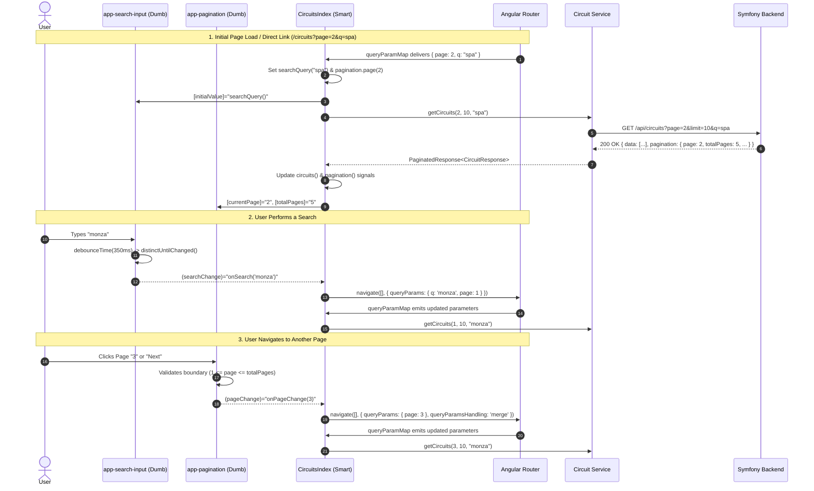

# 🔍 Reusable Search & Pagination Architecture (Angular)

Technical documentation and architectural specification for the reusable **Search Input** and **Pagination** components, including data models, reactive state orchestration, and URL query parameter synchronization.

---

## 📑 Table of Contents
1. [Overview & Design Principles](#-overview--design-principles)
2. [Component Architecture & Data Flow](#-component-architecture--data-flow)
3. [Data Models & Types](#-data-models--types)
   - [`PaginationMeta`](#paginationmeta)
   - [`PaginatedResponse<T>`](#paginatedresponset)
4. [Search Component (`SearchInput`)](#-search-component-searchinput)
   - [Inputs & Outputs](#inputs--outputs)
   - [Internal Reactive Pipeline](#internal-reactive-pipeline)
   - [Template & UI Controls](#template--ui-controls)
5. [Pagination Component (`Pagination`)](#-pagination-component-pagination)
   - [Inputs & Outputs](#inputs--outputs-1)
   - [Dynamic Sliding Window Algorithm](#dynamic-sliding-window-algorithm)
   - [Template & Navigation Controls](#template--navigation-controls)
6. [Container Orchestration (`CircuitsIndex`)](#-container-orchestration-circuitsindex)
   - [Standalone Component Registration](#standalone-component-registration)
   - [State Management with Signals](#state-management-with-signals)
   - [URL Synchronization & History Support](#url-synchronization--history-support)
   - [Template Integration](#template-integration)
7. [Step-by-Step Reusability Guide (e.g. `/cars`)](#-step-by-step-reusability-guide-eg-cars)
8. [Best Practices & Troubleshooting](#-best-practices--troubleshooting)

---

## 🎯 Overview & Design Principles

This architecture decouples presentational user controls from business logic and HTTP communication using the **Smart Container / Dumb Component** pattern.

### Core Principles
1. **Dumb / Presentational Child Components**:
   - [`SearchInput`](file:///opt/lampp/htdocs/track_your_time/frontend/src/app/components/search-input/search-input.ts#L12) and [`Pagination`](file:///opt/lampp/htdocs/track_your_time/frontend/src/app/components/pagination/pagination.ts#L9) have **zero knowledge** of backend entities, API routes, or HTTP clients.
   - They strictly receive data via modern Angular Signal `input()` and notify parents via `output()`.
2. **Smart Orchestrator Parent Components**:
   - The parent container (such as [`CircuitsIndex`](file:///opt/lampp/htdocs/track_your_time/frontend/src/app/components/circuits-index/circuits-index.ts#L13) or `CarIndex`) manages local state, executes API calls, and synchronizes with the browser address bar.
3. **URL as the Single Source of Truth**:
   - Page numbers and search filters are synchronized with URL query parameters (`?page=2&q=silverstone`).
   - Users can bookmark, reload, or share links, and browser back/forward buttons function correctly without broken state.
4. **Performance & Leak Prevention**:
   - Input debouncing prevents unnecessary API request floods.
   - RxJS subscriptions automatically clean up via `takeUntilDestroyed`.

---

## 🏗 Component Architecture & Data Flow



---

## 📦 Data Models & Types

File location: [`src/app/models/paginated-response.ts`](file:///opt/lampp/htdocs/track_your_time/frontend/src/app/models/paginated-response.ts)

```typescript
export interface PaginationMeta {
  page: number;
  limit: number;
  total: number;
  totalPages: number;
}

export interface PaginatedResponse<T> {
  data: T[];
  pagination: PaginationMeta;
}
```

### `PaginationMeta`
Defines the metadata structure returned by all paginated backend endpoints:
* `page`: Current active page index (1-based index).
* `limit`: Maximum number of records per page (e.g. `10`).
* `total`: Total number of records matching the query in the database.
* `totalPages`: Computed ceiling of total pages (`ceil(total / limit)`).

### `PaginatedResponse<T>`
A generic interface wrapping any entity list:
* When fetching circuits: `PaginatedResponse<CircuitResponse>`.
* When fetching cars: `PaginatedResponse<CarResponse>`.
* Guarantees compile-time type safety for `res.data` while sharing identical pagination metadata handling across the entire application.

---

## 🔎 Search Component (`SearchInput`)

* **Selector:** `app-search-input`
* **Source:** [`src/app/components/search-input/search-input.ts`](file:///opt/lampp/htdocs/track_your_time/frontend/src/app/components/search-input/search-input.ts)
* **Template:** [`src/app/components/search-input/search-input.html`](file:///opt/lampp/htdocs/track_your_time/frontend/src/app/components/search-input/search-input.html)
* **Module Import:** `ReactiveFormsModule`

### Inputs & Outputs

| Name | Type | Direction | Default | Description |
| :--- | :--- | :--- | :--- | :--- |
| `placeholder` | `input<string>` | Input | `'Search...'` | Text displayed when the input is empty. |
| `debounceMs` | `input<number>` | Input | `350` | Debounce delay in milliseconds. |
| `initialValue` | `input<string>` | Input | `''` | Value used to pre-fill the input (e.g., from URL query parameter). |
| `searchChange` | `output<string>` | Output | — | Emits the debounced search keyword. |

### Internal Reactive Pipeline

```typescript
export class SearchInput implements OnInit {
  private destroyRef = inject(DestroyRef);

  placeholder = input<string>("Search...");
  debounceMs = input<number>(350);
  initialValue = input<string>("");

  searchChange = output<string>();
  searchControl = new FormControl("");

  ngOnInit(): void {
    // 1. Pre-fill without emitting a change event
    if (this.initialValue()) {
      this.searchControl.setValue(this.initialValue(), { emitEvent: false });
    }

    // 2. Debounce and emit value changes
    this.searchControl.valueChanges.pipe(
      debounceTime(this.debounceMs()),
      distinctUntilChanged(),
      takeUntilDestroyed(this.destroyRef)
    ).subscribe(value => {
      this.searchChange.emit(value ?? "");
    });
  }

  clear(): void {
    this.searchControl.setValue("");
  }
}
```

#### Key Mechanics:
1. `{ emitEvent: false }`:
   When initializing from `initialValue`, setting `emitEvent: false` prevents an immediate redundant event emission and avoids circular API calls during component mounting.
2. `debounceTime(this.debounceMs())`:
   Waits until the user stops typing for 350ms before emitting. This reduces unnecessary backend load by up to 90% during active typing.
3. `distinctUntilChanged()`:
   Ensures that non-character keystrokes (such as arrow keys, Shift, or Command) do not trigger an emission if the string content hasn't changed.
4. `takeUntilDestroyed(this.destroyRef)`:
   Automatically unsubscribes from `valueChanges` when the component is destroyed, preventing memory leaks.

### Template & UI Controls

```html
<div class="relative w-full max-w-md">
  <input
    type="text"
    [formControl]="searchControl"
    [placeholder]="placeholder()"
    class="w-full px-4 py-2 border border-gray-700 bg-neutral-900 text-white rounded-lg focus:outline-none focus:border-red-500 transition-colors"
  />
  @if (searchControl.value) {
    <button
      type="button"
      (click)="clear()"
      class="absolute right-3 top-1/2 -translate-y-1/2 text-gray-400 hover:text-white"
    >
      ✕
    </button>
  }
</div>
```
* **Clear Button (`✕`)**: Displayed conditionally using Angular control flow (`@if`) when input is not empty. Clicking it resets `searchControl`, triggering a debounced emit of `""` to clear filters.

---

## 📄 Pagination Component (`Pagination`)

* **Selector:** `app-pagination`
* **Source:** [`src/app/components/pagination/pagination.ts`](file:///opt/lampp/htdocs/track_your_time/frontend/src/app/components/pagination/pagination.ts)
* **Template:** [`src/app/components/pagination/pagination.html`](file:///opt/lampp/htdocs/track_your_time/frontend/src/app/components/pagination/pagination.html)

### Inputs & Outputs

| Name | Type | Direction | Required | Description |
| :--- | :--- | :--- | :--- | :--- |
| `currentPage` | `input.required<number>()` | Input | Yes | Current active page (1-based index). |
| `totalPages` | `input.required<number>()` | Input | Yes | Total number of pages available. |
| `pageChange` | `output<number>()` | Output | — | Emits target page number on user navigation. |

### Dynamic Sliding Window Algorithm

Rather than rendering all pages (which breaks layouts when dealing with large datasets), a reactive computed signal dynamically generates a 5-page window centered around the active page (`currentPage ± 2`):

```typescript
pages = computed(() => {
  const total = this.totalPages();
  const current = this.currentPage();

  const delta = 2;
  const start = Math.max(1, current - delta);
  const end = Math.min(total, current + delta);
  
  const list: number[] = [];
  for (let i = start; i <= end; i++) {
    list.push(i);
  }
  return list;
});
```

#### Sliding Window Examples:
* **`total = 10`, `current = 1`:** Window is `[1, 2, 3]` (start capped at 1).
* **`total = 10`, `current = 5`:** Window is `[3, 4, 5, 6, 7]`.
* **`total = 10`, `current = 10`:** Window is `[8, 9, 10]` (end capped at 10).

### Safe Navigation (`goToPage`)

```typescript
goToPage(page: number): void {
  if (page >= 1 && page <= this.totalPages() && page !== this.currentPage()) {
    this.pageChange.emit(page);
  }
}
```
* Protects against out-of-range emissions.
* Ignores redundant clicks on the already active page button.

### Template & Navigation Controls

```html
@if (totalPages() > 1) {
  <div class="flex items-center justify-center gap-2 mt-6 select-none">
    <!-- Previous Button -->
    <button
      (click)="goToPage(currentPage() - 1)"
      [disabled]="currentPage() <= 1"
      class="px-3 py-1.5 rounded border border-gray-700 text-sm disabled:opacity-40 disabled:cursor-not-allowed hover:bg-neutral-800 transition"
    >
      Previous
    </button>

    <!-- Page Number Buttons -->
    @for (page of pages(); track page) {
      <button
        (click)="goToPage(page)"
        [class.bg-red-600]="page === currentPage()"
        [class.text-white]="page === currentPage()"
        [class.border-red-600]="page === currentPage()"
        class="px-3 py-1.5 rounded border border-gray-700 text-sm hover:bg-neutral-800 transition"
      >
        {{ page }}
      </button>
    }

    <!-- Next Button -->
    <button
      (click)="goToPage(currentPage() + 1)"
      [disabled]="currentPage() >= totalPages()"
      class="px-3 py-1.5 rounded border border-gray-700 text-sm disabled:opacity-40 disabled:cursor-not-allowed hover:bg-neutral-800 transition"
    >
      Next
    </button>
  </div>
}
```
* **Auto-Hide:** Wrapped in `@if (totalPages() > 1)`. If all records fit on one page, the entire pagination bar is removed from the DOM.
* **Accessible States:** `Previous` is disabled when `currentPage <= 1`; `Next` is disabled when `currentPage >= totalPages()`.

---

## 🎛 Container Orchestration (`CircuitsIndex`)

* **Source:** [`src/app/components/circuits-index/circuits-index.ts`](file:///opt/lampp/htdocs/track_your_time/frontend/src/app/components/circuits-index/circuits-index.ts)
* **Template:** [`src/app/components/circuits-index/circuits-index.html`](file:///opt/lampp/htdocs/track_your_time/frontend/src/app/components/circuits-index/circuits-index.html)

### Standalone Component Registration

To render `<app-search-input>` and `<app-pagination>`, both child components must be registered in the container's `imports` array:

```typescript
import { Component, inject, OnInit, signal } from '@angular/core';
import { ActivatedRoute, Router } from '@angular/router';
import { Circuit } from '../../services/circuit';
import { CircuitResponse } from '../../models/circuit-response';
import { PaginationMeta } from '../../models/paginated-response';
import { SearchInput } from '../search-input/search-input';
import { Pagination } from '../pagination/pagination';

@Component({
  selector: 'app-circuits-index',
  imports: [SearchInput, Pagination],
  templateUrl: './circuits-index.html',
  styleUrl: './circuits-index.css',
})
export class CircuitsIndex implements OnInit { ... }
```

### State Management with Signals

```typescript
circuits = signal<CircuitResponse[]>([]);
pagination = signal<PaginationMeta>({ page: 1, limit: 10, total: 0, totalPages: 0 });
searchQuery = signal<string>("");
loading = signal<boolean>(false);
```

### URL Synchronization & History Support

The container subscribes to `route.queryParamMap` as the single driver for state and API calls:

```typescript
ngOnInit(): void {
  this.route.queryParamMap.subscribe(params => {
    const page = Number(params.get("page")) || 1;
    const q = params.get("q") || "";

    this.searchQuery.set(q);
    this.loadCircuits(page, q);
  });
}
```

#### Event Handlers Update the Router (Not Local State Directly):

```typescript
onSearch(query: string): void {
  this.router.navigate([], {
    relativeTo: this.route,
    queryParams: { q: query || null, page: 1 }, // Reset to page 1 on new search
    queryParamsHandling: "merge",
  });
}

onPageChange(page: number): void {
  this.router.navigate([], {
    relativeTo: this.route,
    queryParams: { page },
    queryParamsHandling: "merge",
  });
}
```

* `queryParamsHandling: 'merge'`: Preserves any other existing query parameters.
* `q: query || null`: Setting an empty search query to `null` cleanly deletes the `?q=` param from the URL rather than leaving `?q=`.
* Resetting to `page: 1` on search: Prevents being stuck on an empty page if the previous search had 10 pages and the new search only has 1.

### Template Integration

```html
<div class="container mx-auto px-4 py-8">
  <div class="flex flex-col sm:flex-row justify-between items-center mb-6 gap-4">
    <h1 class="text-2xl font-bold text-white">Circuits</h1>

    <!-- 1. Search Component -->
    <app-search-input
      placeholder="Search circuit by name or city..."
      [initialValue]="searchQuery()"
      (searchChange)="onSearch($event)"
    />
  </div>

  <!-- Loading State -->
  @if (loading()) {
    <div class="text-center py-10 text-gray-400">Loading circuits...</div>
  } @else if (circuits().length === 0) {
    <div class="text-center py-10 text-gray-400">No circuits found.</div>
  } @else {
    <!-- Grid -->
    <div class="grid grid-cols-1 md:grid-cols-2 lg:grid-cols-3 gap-6">
      @for (circuit of circuits(); track circuit.id) {
        <div class="bg-neutral-900 border border-neutral-800 rounded-lg p-4">
          <h2 class="text-lg font-semibold text-white">{{ circuit.name }}</h2>
          <p class="text-sm text-gray-400">{{ circuit.address }}</p>
        </div>
      }
    </div>

    <!-- 2. Pagination Component -->
    <app-pagination
      [currentPage]="pagination().page"
      [totalPages]="pagination().totalPages"
      (pageChange)="onPageChange($event)"
    />
  }
</div>
```

---

## 🚀 Step-by-Step Reusability Guide (e.g. `/cars`)

Follow these 3 steps to replicate search and pagination in any other listing page:

### Step 1: Ensure Service Returns `PaginatedResponse<T>`

In [`src/app/services/car.ts`](file:///opt/lampp/htdocs/track_your_time/frontend/src/app/services/car.ts):

```typescript
import { HttpClient, HttpParams } from '@angular/common/http';
import { inject, Injectable } from '@angular/core';
import { Observable } from 'rxjs';
import { CarResponse } from '../models/car-response';
import { PaginatedResponse } from '../models/paginated-response';

@Injectable({ providedIn: 'root' })
export class CarService {
  private http = inject(HttpClient);

  getCars(page: number = 1, limit: number = 10, search: string = ''): Observable<PaginatedResponse<CarResponse>> {
    let params = new HttpParams()
      .set('page', page.toString())
      .set('limit', limit.toString());

    if (search.trim()) {
      params = params.set('q', search.trim());
    }

    return this.http.get<PaginatedResponse<CarResponse>>('/api/cars', {
      params,
      withCredentials: true,
    });
  }
}
```

### Step 2: Implement Container Component (`CarIndex`)

In `src/app/components/car-index/car-index.ts`:

```typescript
import { Component, inject, OnInit, signal } from '@angular/core';
import { ActivatedRoute, Router } from '@angular/router';
import { CarService } from '../../services/car';
import { CarResponse } from '../../models/car-response';
import { PaginationMeta } from '../../models/paginated-response';
import { SearchInput } from '../search-input/search-input';
import { Pagination } from '../pagination/pagination';

@Component({
  selector: 'app-car-index',
  imports: [SearchInput, Pagination],
  templateUrl: './car-index.html',
})
export class CarIndex implements OnInit {
  private carService = inject(CarService);
  private route = inject(ActivatedRoute);
  private router = inject(Router);

  cars = signal<CarResponse[]>([]);
  pagination = signal<PaginationMeta>({ page: 1, limit: 10, total: 0, totalPages: 0 });
  searchQuery = signal<string>('');
  loading = signal<boolean>(false);

  ngOnInit(): void {
    this.route.queryParamMap.subscribe(params => {
      const page = Number(params.get('page')) || 1;
      const q = params.get('q') || '';
      this.searchQuery.set(q);
      this.loadCars(page, q);
    });
  }

  loadCars(page: number, query: string): void {
    this.loading.set(true);
    this.carService.getCars(page, 10, query).subscribe({
      next: (res) => {
        this.cars.set(res.data);
        this.pagination.set(res.pagination);
        this.loading.set(false);
      },
      error: () => this.loading.set(false),
    });
  }

  onSearch(query: string): void {
    this.router.navigate([], {
      relativeTo: this.route,
      queryParams: { q: query || null, page: 1 },
      queryParamsHandling: 'merge',
    });
  }

  onPageChange(page: number): void {
    this.router.navigate([], {
      relativeTo: this.route,
      queryParams: { page },
      queryParamsHandling: 'merge',
    });
  }
}
```

### Step 3: Embed Components in Template

In `src/app/components/car-index/car-index.html`:

```html
<app-search-input
  placeholder="Search car by make, model, or year..."
  [initialValue]="searchQuery()"
  (searchChange)="onSearch($event)"
/>

<!-- Car List/Grid View -->

<app-pagination
  [currentPage]="pagination().page"
  [totalPages]="pagination().totalPages"
  (pageChange)="onPageChange($event)"
/>
```

---

## 🛠 Best Practices & Troubleshooting

| Issue / Pitfall | Cause | Solution |
| :--- | :--- | :--- |
| `<app-search-input>` or `<app-pagination>` not rendered | Component missing from parent `imports: []` | Add `[SearchInput, Pagination]` to container's `@Component({ imports: [...] })`. |
| Typing in search triggers double API requests | `setValue()` in `ngOnInit` emitting events | Ensure `{ emitEvent: false }` is passed when setting initial values in `SearchInput`. |
| Querying a page beyond total results returns empty list | User searched while on page 5, but new search only has 1 page | Always pass `page: 1` when navigating in `onSearch()`. |
| Unsubscribing memory leaks | Unclosed RxJS stream in `valueChanges` | Use `takeUntilDestroyed(this.destroyRef)` inside the component injection context. |
| URL has empty `?q=` | Setting `q: ""` in navigation | Use `q: query || null` in `router.navigate()`. Angular removes query parameters assigned `null`. |
